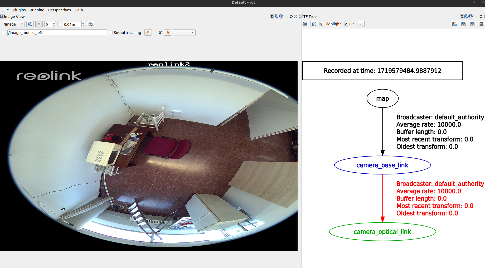

# ip_camera_ros2

[](https://opensource.org/licenses/Apache-2.0)
[](https://github.com/grupo-avispa/ip_camera_ros2/actions/workflows/build.yml)

## Overview
This ROS2 package provides a generic interface for publishing RGB image from any IP camera. I also includes a static transform publisher and camera info publisher in case you need any of these applications.

*RGB image and transform published:*



The ip_camera_ros2 package has been tested under [ROS2] lyrical on [Ubuntu] 26.04. This is research code, expect that it changes often and any fitness for a particular purpose is disclaimed.

## Installation
### Building from Source

#### Dependencies

- [Robot Operating System (ROS) 2](https://docs.ros.org/en/lyrical/) (middleware for robotics),
- [OpenCV](https://opencv.org/) (computer vision library),
- [cv_bridge](http://wiki.ros.org/cv_bridge) (interface OpenCV with ROS),
- [compressed_image_transport](https://github.com/ros-perception/image_transport_plugins) (JPEG encoding for the `image/compressed` topic; only needed to view it, not to publish)

#### Building

To build from source, clone the latest version from the main repository into your colcon workspace by running the following commands:
```bash
cd colcon_workspace/src
git clone https://github.com/grupo-avispa/ip_camera_ros2.git -b lyrical
```

Then, install the ROS2 dependencies using rosdep and build the package using:
```bash
cd colcon_workspace
rosdep install -i --from-path src --rosdistro lyrical -y
colcon build --symlink-install
```

## Usage

## Only Image Mode

Connect your ip camera and set up the url in the `params.yaml` file under `config` directory.
```bash
ros2 launch ip_camera_ros2 image.launch.py
```
It publishes no TF. The `namespace` argument allows launching several cameras; the parameters file applies to any namespace.
## Image and TF Mode
Connect your ip camera and set up the url in the `params.yaml` file under `config` directory. Then configure the `camera.xacro` file under `urdf` directory with your needs (template provided). The pose of the camera in its parent frame is given with the launch arguments `x`, `y`, `z` (meters), `roll`, `pitch`, `yaw` (radians) and `parent_frame` (default `map`).
```bash
ros2 launch ip_camera_ros2 image_and_tf.launch.py z:=2.7 roll:=3.14159
```
`publish_tf:=false` disables both the static transform and the robot state publisher. Use it, or `image.launch.py`, if another node publishes the pose of the camera, so that `camera_optical_link` does not get two parents.
### Camera calibration

Camera info is only published when `enable_cam_info` is true and the calibration is valid: `camera_matrix` must have positive focal lengths and `1` as its last element, and the number of `distortion_coefficients` must match the `distortion_model`. The template has camera info disabled, because its calibration is all zeros.

The node offers the `set_camera_info` service, so that the COMMIT button of `camera_calibration` applies a calibration to the running node as parameters. `ros2 param dump /ip_camera_ros2` then gives the values to persist in the parameters file. [doc/fisheye_calibration.md](doc/fisheye_calibration.md) explains how to calibrate a fisheye camera step by step. `camera_info_manager` with a `camera_info_url` is the standard alternative, but it would change where this package keeps its calibration.

If the published image has a different size than the calibrated one (`calibration_width`, `calibration_height`), camera info is not published and a warning explains why, because intrinsics in pixels of another image would silently produce distorted results.

### Time stamps

Every frame is stamped when it arrives from the stream at the host, in the capture thread, and not when the timer publishes it, so the stamp does not carry the variable delay of the timer. This is the arrival time and not the exposure time. The constant latency of the camera, the stream and the decoder can be compensated with `stamp_offset`, which is subtracted from the stamp. It is a constant and approximate correction that has to be measured separately.

### Lifecycle

`ip_camera_ros2` is a [managed lifecycle node](https://design.ros2.org/articles/node_lifecycle.html): the RTSP stream is only opened once the node is activated, and closed again on deactivation. Both launch files pass `autostart:=true` by default, which automatically configures and activates the node on startup, so the commands above work out of the box.

To drive the lifecycle manually (e.g. to orchestrate startup alongside other nodes with a lifecycle manager), disable autostart and use the standard lifecycle CLI/services:
```bash
ros2 launch ip_camera_ros2 image.launch.py autostart:=false
ros2 lifecycle set /ip_camera_ros2 configure
ros2 lifecycle set /ip_camera_ros2 activate
```

### Nodes

#### ip_camera_ros2

This lifecycle node publishes image from the ip camera and camera information (if this option is enabled).

#### camera_state_publisher
State publisher node from robot_state_publisher package.

#### ipcam_tf

Static transform publisher from tf2_ros package.

### Services

* **`set_camera_info`** ([sensor_msgs/SetCameraInfo])

	Applies a calibration to the node as parameters. It lives in the namespace of `image_topic` (e.g. `/image` -> `/set_camera_info`, `/ceil01/image` -> `/ceil01/set_camera_info`). The calibration is refused, with the reason in `status_message`, if it is not valid.

### Published Topics

* **`image`** ([sensor_msgs/Image])

	The camera image.

* **`image/compressed`** ([sensor_msgs/CompressedImage])

	JPEG-compressed version of `image`, for viewing over a bandwidth-constrained link (e.g. `rqt_image_view` set to the `compressed` transport). Only published while someone is subscribed to it.

* **`camera_info`** ([sensor_msgs/CameraInfo])

	Defined meta information for a camera. Published only when `enable_cam_info` is true, the calibration is valid and the image has the calibrated size, on the standard sibling topic derived from `image_topic` (e.g. `/image` -> `/camera_info`). It has the same stamp as the image.

* **`joint_states`**
* **`robot_description`**
* **`tf_static`**
* **`tf`**

	These topic are generated by the camera_state_publisher and ipcam_tf nodes.

### Parameters

* **`image_topic`** (string, default: "/image")

	Topic where the image will be published. When `enable_cam_info` is true, camera info is published on the sibling topic derived from this one (e.g. `/image` -> `/camera_info`); it is not independently configurable.

* **`image_height`** (int, default: -1)

	Final image height after resize or crop (set to -1 if not used).

* **`image_width`** (int, default: -1)

	Final image width after resize or crop (set to -1 if not used).

* **`offset_x`** (int, default: -1)

	Image X top left corner pixel before crop (set to -1 if not used).

* **`offset_y`** (int, default: -1)

	Image Y top left corner pixel before crop (set to -1 if not used).

	If `image_height`, `image_width`, `offset_x` and `offset_y` are greater than zero, 
	crop image tranformation will be applied. If only `image_height` and `image_width` are greater 
	than zero, resize image tranformation will be applied. If `image_height` and `image_width` are 
	smaller than zero no transformations will be applied.

* **`url`** (string, default: "ipcam_url")

	Url for ip camera connection.

* **`tf`** (string, default: "camera_optical_link")

	Camera selected frame where the image will be published.

* **`frame_rate`** (int, default: 30)

	Image publishing frame rate in Hz. Values lower than 1 are clamped to 1.

* **`buffer_size`** (int, default: 2)

	Maximum number of frames the producer thread accumulates before the consumer drains them. Only the most recent frame is ever published, so this mainly bounds the worst-case memory usage of the buffer.

* **`stamp_offset`** (double, default: 0.0)

	Seconds subtracted from the time a frame reaches the host to get its stamp, to compensate the constant latency of the camera and the stream.

* **`enable_cam_info`** (bool, default: false)

	Enables camera info publishing. Can be changed at runtime.

* **`distortion_model`** (string)
* **`camera_matrix`** (double array)
* **`distortion_coefficients`** (double array)
* **`rectification_matrix`** (double array)
* **`projection_matrix`** (double array)

	Meta information about intrinsic and extrinsic parameters of the camera obtained from calibration. They can be changed at runtime, and `set_camera_info` sets them. The number of coefficients must be 4 for `equidistant`, 5 for `plumb_bob` and 8 for `rational_polynomial`.

* **`calibration_width`** (int, default: -1)
* **`calibration_height`** (int, default: -1)

	Size of the image the camera was calibrated with. If they are set and the published image has another size, camera info is not published. -1 disables the check.


[Ubuntu]: https://ubuntu.com/
[ROS2]: https://docs.ros.org/en/jazzy/
[sensor_msgs/Image]: https://docs.ros2.org/jazzy/api/sensor_msgs/msg/Image.html
[sensor_msgs/CompressedImage]: https://docs.ros2.org/jazzy/api/sensor_msgs/msg/CompressedImage.html
[sensor_msgs/CameraInfo]: https://docs.ros2.org/jazzy/api/sensor_msgs/msg/CameraInfo.html
[sensor_msgs/SetCameraInfo]: https://docs.ros2.org/jazzy/api/sensor_msgs/srv/SetCameraInfo.html